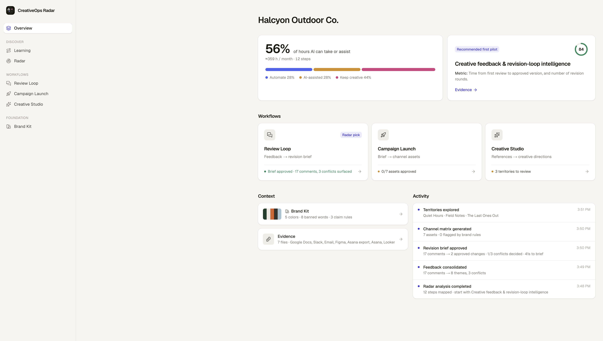

# CreativeOps Radar

**Let AI take the busywork. Keep the creative work creative.**

Enterprise marketing teams are adopting AI before they know which part of their workflow actually deserves it. CreativeOps Radar reads the evidence a campaign already leaves behind — briefs, Slack and email feedback, Figma comments, approval timelines, request queues, channel results — reconstructs the real process, and shows which steps AI should **automate**, which it should **assist**, and which should **stay human and creative**. Then it runs the top opportunity as a pilot with a human gate before anything ships, and measures it against the team's own baseline.

Built for the [Innovation Intelligence Hackathon](docs/HACKATHON.md) at UC Berkeley (AI-Native Enterprise track), Oct 2026.



## What's in the platform

| Area | What it does |
| --- | --- |
| **Workflow Learning** (discover) | Shows how the platform learns a manual workflow: connect sources → extract events (who, what, when, which stage) → reconstruct the real path with loops, handoffs, and manual work → the team confirms each step → measure the pilot. Includes 7 mapped real-world cases (creative review, channel adaptation, pharma MLR review, localization, performance reporting, request intake, creator content), each step tagged with the signal it is learned from. |
| **Radar** (discover) | Maps the workflow from evidence, splits hours into automate / AI-assisted / keep creative, and ranks opportunities on 7 transparent dimensions. Every claim links to a verbatim quote from the source. |
| **Review Loop** (pilot #1) | Turns scattered feedback from Slack, email, and Figma into themes, duplicates, contradictions (including conflicts with the brand book), one blocking decision with a named owner, and a revision brief that only fills with human-approved changes. |
| **Campaign Launch** | Adapts an approved brief into every channel spec (Instagram, TikTok, Meta, display, email, search, web, retail, LinkedIn) with character limits and a live, deterministic brand check. A person approves each asset; nothing auto-publishes. |
| **Creative Studio** | A sparring partner, not a replacement: a reference board plus safe / stretch / bold territories built from the brand system. The team picks a direction. |
| **Brand Kit** | The brand book as rules AI can follow: palette, typography, voice, banned words, and approved claims. The checker runs as code, so no prompt can talk its way around a banned word. |

### Principles baked into the product

- **Evidence first.** Quotes are checked verbatim against the source and marked verified or unverified in the UI.
- **No invented numbers.** Hours come from the timeline and request queue; assumptions are listed on the page. Sample data is labeled **Synthetic** everywhere.
- **People own the creative calls.** AI never picks a side in a conflict, and every workflow ends at a human approval.
- **Out of scope by design:** auto-publishing and autonomous brand or legal approval.

## Run it

```bash
npm install
npm run dev
```

Open http://localhost:3000. The workspace comes preloaded with a synthetic company (Halcyon Outdoor Co.) so the full flow works immediately. **Reset demo workspace** in the sidebar restores it.

### AI engine

Without an API key, every workflow runs on a deterministic local engine (rules and parsers in `src/lib/engine/`), so the demo never depends on network access. To use an LLM, create `.env.local`:

```bash
cp .env.example .env.local
# then set OPENAI_API_KEY or ANTHROPIC_API_KEY
```

| Variable | Default | Notes |
| --- | --- | --- |
| `OPENAI_API_KEY` | — | Uses `gpt-5.4-mini` unless `AI_MODEL` is set. |
| `ANTHROPIC_API_KEY` | — | Uses `claude-sonnet-5-5` unless `AI_MODEL` is set. |
| `AI_PROVIDER` | auto | `openai` or `anthropic` when both keys are present. |
| `AI_MODEL` | per provider | Any model id the provider supports. |

The sidebar shows which engine is active. If an LLM call fails, the route falls back to the local engine and the result is stamped with a warning. Add `?engine=local` to any `/api/ai/*` call to force the local engine.

## Architecture

- **Next.js 16** (App Router), React 19, Tailwind v4, TypeScript.
- **AI SDK v7** structured output: `generateText` + `Output.object` with the zod schemas in `src/lib/schemas.ts`. The same schemas type the local engines, so both paths return identical shapes.
- `POST /api/ai/[task]` (`radar`, `review`, `launch`, `studio`) validates input with zod and returns `{ result, engine, warning }`. `GET /api/status` reports the active engine.
- Workspace state (evidence, brand kit, decisions, approvals, activity log) persists in the browser via zustand. No database is needed for the demo.
- Scoring is transparent and lives in `src/lib/scoring.ts`: impact 25%, frequency 15%, AI fit 15%, data readiness 10%, risk 15% (inverted), effort 10% (inverted), measurement 10%.
- Interaction design follows [Emil Kowalski's skills](https://github.com/emilkowalski/skills): custom ease-out curves, press feedback, staggered entrances, no animating from `scale(0)`, and full `prefers-reduced-motion` support. UI primitives come from Base UI and Sonner.

```
src/
  app/                 routes + API (api/ai/[task], api/status)
  components/          app shell, UI kit, one folder per workflow
  lib/
    engine/            local engines: radar, review, launch, studio
    ai/                provider resolution + prompts
    schemas.ts         zod contracts shared by LLM and local engines
    scoring.ts         opportunity scoring + hour split
    brandcheck.ts      deterministic brand rules
    seed.ts            synthetic demo workspace
```

## Scripts

```bash
npm run dev     # dev server
npm run build   # production build
npm run lint    # eslint
npx tsc --noEmit
```
