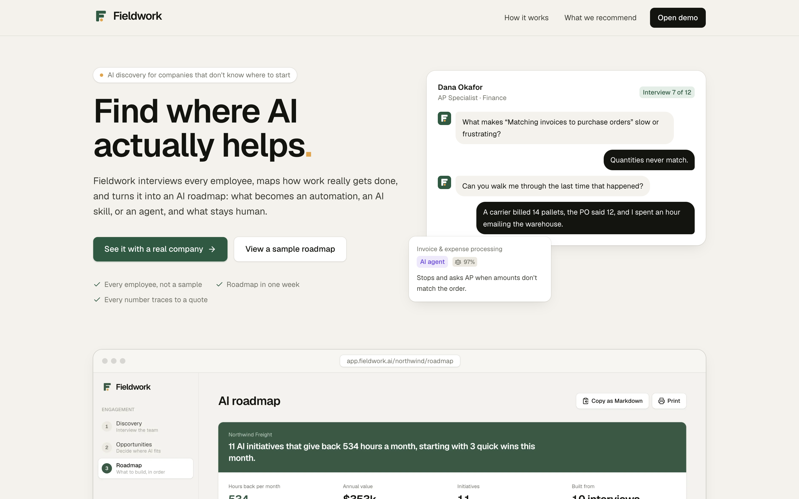
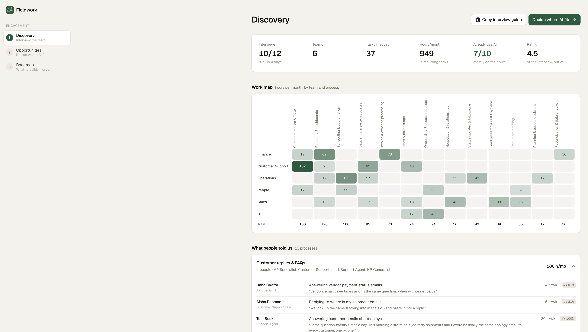
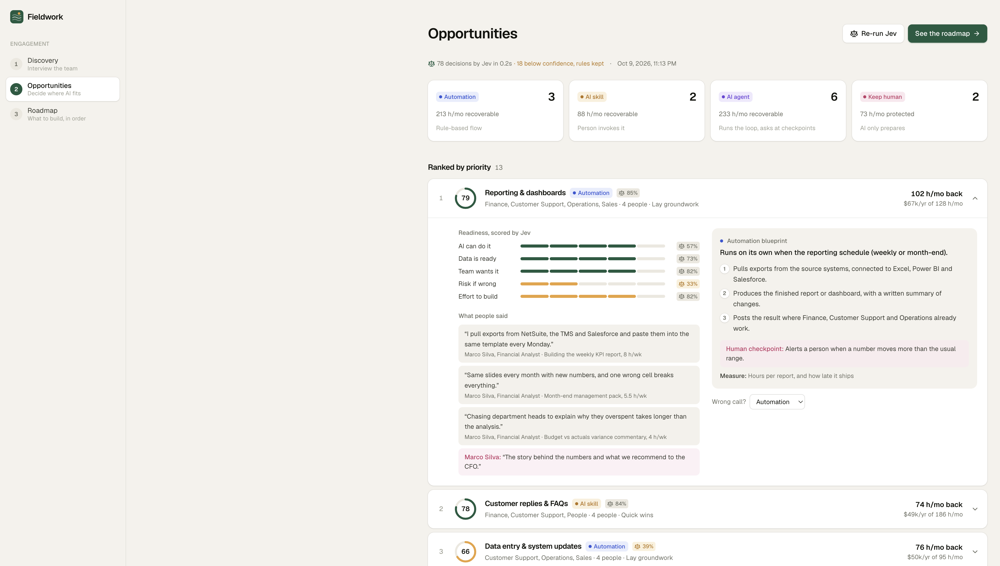
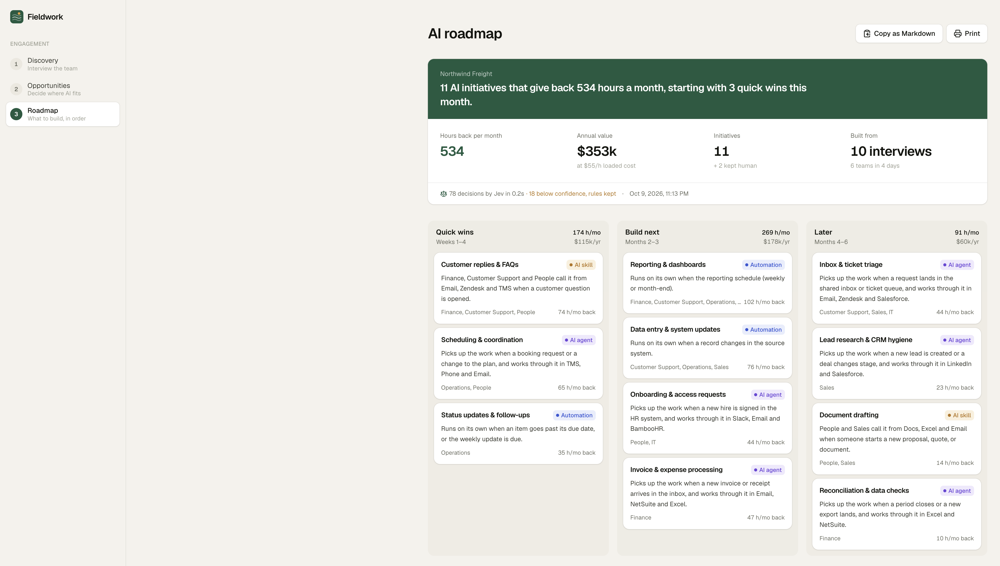

# Fieldwork

**Find where AI actually helps.**

Fieldwork interviews a statistically planned sample across every team, maps how work really gets done, and turns it into an AI roadmap: what becomes an automation, an AI skill, or an agent, and what stays human.

Every company has an AI mandate and no idea where to start. Leaders guess from the top, consultants interview whoever is easiest to reach, and the people who know where the hours go are often missed. Fieldwork plans coverage by team, runs the selected interviews in parallel, and uses a decision model to turn the evidence into a ranked roadmap in a week.



## Two workflows

| Workflow | What it does | Where |
| --- | --- | --- |
| **1. Discovery** | A server-side LangGraph interviewer talks to each employee for about 8 minutes: their repeated tasks, hours, tools, friction, handoffs, AI use, and human boundaries. Every answer is extracted into a work record, checked by Jev or a local guardrail, routed, and checkpointed for review. | `/discovery` |
| **2. Decision** | [Jev](https://typesafe.ai), a decision model, reads each process with the employees' own words and decides the right type of AI (automation, AI skill, AI agent, or keep human), scores readiness on five dimensions, and reports its confidence. Low-confidence calls keep the rule-based answer and are flagged for a person. | `/opportunities` |
| **Roadmap** | Ranked initiatives in three phases (quick wins, build next, later), each with a blueprint, a human checkpoint, and the metric to measure it. Exports to Markdown. Re-interview in 90 days to measure what came back. | `/roadmap` |

The landing page at `/` is the brand. See [docs/BRAND.md](docs/BRAND.md).





## Run it

```bash
npm install
npm run dev
```

Open http://localhost:3000. The workspace comes preloaded with a synthetic client, Northwind Freight (logistics, 640 employees): 10 completed interviews across Finance, Customer Support, Operations, People, Sales, and IT, plus 2 invited. **Reset demo workspace** in the sidebar restores it.

### Jev

Create `.env.local` with `JEV_API_KEY` (see `.env.example`). Without it, everything runs on the rule-based catalog and the UI says so.

| Decision | Question type | Applied when |
| --- | --- | --- |
| Which process an interviewed task belongs to (15 processes + Other) | choice | confidence ≥ 0.5 |
| Whether an interview answer should advance, clarify time, or request an example | choice | only from the graph's allowed routes |
| Solution type per process: automation, AI skill, AI agent, keep human | choice | confidence ≥ 0.6 |
| Feasibility, data readiness, risk, effort, adoption | 5-level score | confidence ≥ 0.45 |

Jev sees the tasks, hours, tools, pain quotes, who waits on the work, what people said must stay human, and how they already use AI. Hours, dollars, and priority are computed in code from what people reported, so every number traces back to an interview. In the Northwind seed, Jev makes 78 decisions in about 0.2 seconds.

## How the numbers work

- **Hours per month** = reported hours per week × 4.33.
- **Hours back** = hours × the configured share each solution type typically saves (automation 80%, agent 60%, skill 40%, human 0%).
- **Priority** = 35% value (relative annual value) + 65% readiness (Jev's scores, with risk and effort inverted).
- **Phase**: the top three that AI can do well, at moderate effort, are quick wins; the next four feasible ones are "build next"; the rest come later. Work kept human is listed separately.

## Architecture

```
src/
  app/
    (site)/page.tsx            Landing page (brand)
    (app)/discovery            Workflow 1
    (app)/opportunities        Workflow 2
    (app)/roadmap              The deliverable
    api/interview/next         One complete LangGraph interview turn
    api/decide/tasks           Jev: task → process
    api/decide/opportunities   Jev: solution type + readiness scores
  lib/
    ai/interview-graph.ts      Executable LangGraph nodes, routing, checkpoint
    engine/interview.ts        Interview phases, parsers, question policy
    engine/interview-agent.ts  Shared runtime manifest shown in Discovery
    engine/processes.ts        Process catalog, solution types, blueprints
    engine/opportunities.ts    Grouping, value, priority, phases, Jev payload
    ai/decisions.ts            Jev questions and confidence gating
    seed-interviews.ts         Northwind Freight, run through the real interview engine
```

## Scripts

```bash
npm run dev     # dev server
npm run build   # production build
npm run lint    # eslint
```
