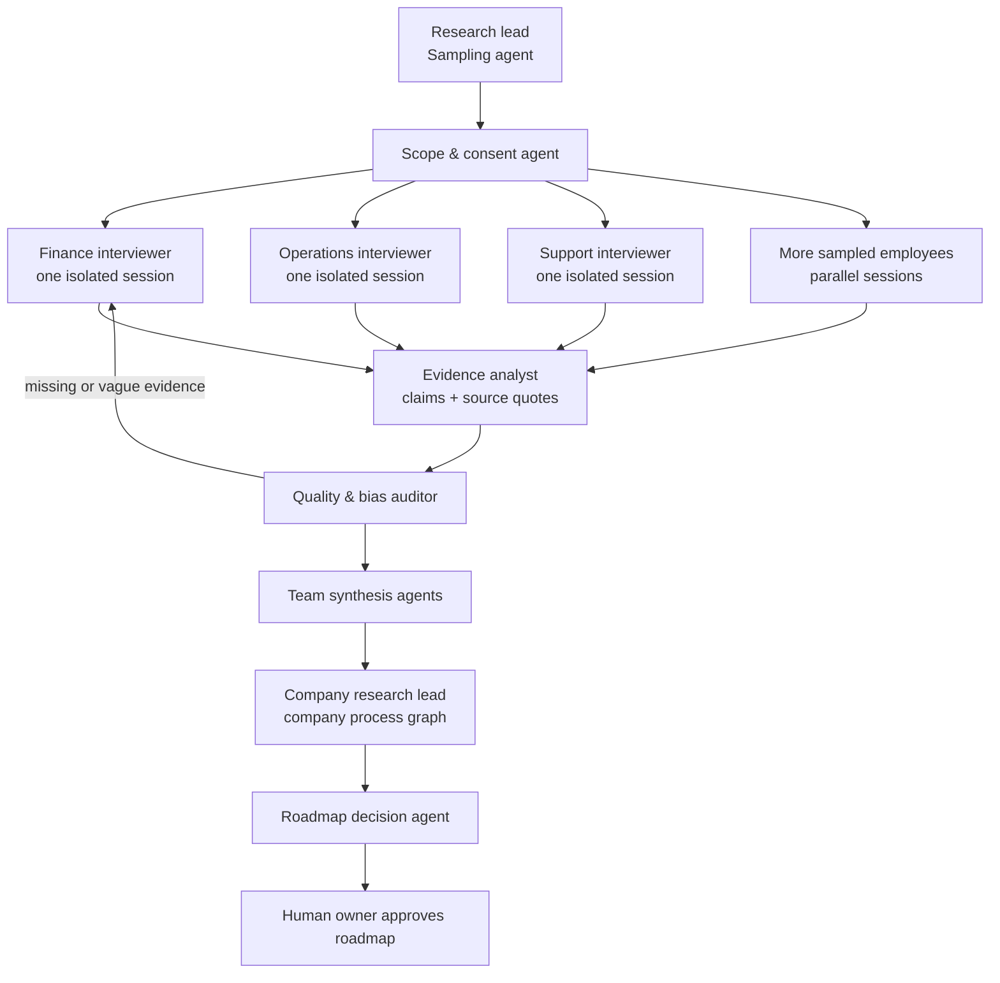
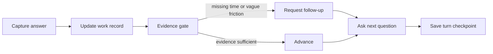
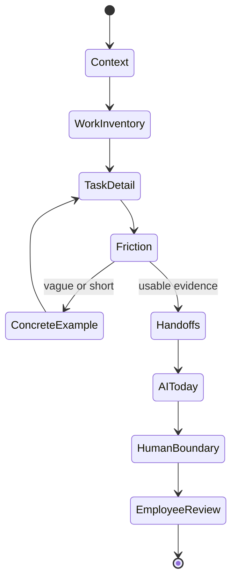

# Fieldwork research agent

Fieldwork is a company research system. Its job is to discover how work really happens, where employees lose time, which tools and handoffs shape the work, where people already use AI, and which decisions must remain human. It should be treated as evidence collection and synthesis, not as a chatbot that improvises an automation recommendation.

## The production-shaped architecture

The graph has separate agent roles because each role has a different failure mode. A single prompt cannot reliably choose a statistically defensible sample, conduct an unbiased interview, preserve quotes, detect weak evidence, and make a high-stakes roadmap decision.



`src/lib/engine/research-graph.ts` is the typed orchestration contract. The browser diagram is generated from the same node definitions and current records. `POST /api/research/graph` exposes the snapshot at a server boundary so it can later be moved to a queue or durable worker without changing the contract.

## Node contracts and gates

| Node | Agent responsibility | Input | Output | Gate |
| --- | --- | --- | --- | --- |
| Sample the company | Choose proportional team quotas and an invite wave | Roster, team sizes, precision target | Team targets and sampling progress | Every team has a target; no team is silently omitted |
| Set scope and consent | Explain collection scope and flag sensitive topics | Participant and company context | Approved session scope | Participation scope is explicit before synthesis |
| Interview employees | Run one bounded adaptive conversation per sampled employee | Role, team, prior answers | Transcript and structured work record | Work, time, tools, friction, waits, AI, and human judgment are covered |
| Extract evidence | Convert answers to claims without losing source text | Transcript and submitted record | Evidence objects linked to the source answer | Every claim has a source; inferences are marked |
| Audit quality and bias | Find vague answers, contradictions, missing fields, and coverage gaps | Evidence and sample progress | Score, risk flags, follow-up queue | Weak evidence loops back or goes to human review |
| Synthesize each team | Group repeated tasks and handoffs while retaining exceptions | Quality-passed evidence | Team maps and confidence | Repeated themes are separated from single-person signals |
| Build the company brain | Connect cross-team processes, dependencies, tools, and policies | Team maps and handoffs | Company graph and opportunity candidates | Each opportunity names teams, evidence, risk, owner, and unknowns |
| Prioritize roadmap | Estimate value and effort after evidence is visible | Opportunities, ROI assumptions, human review | Prioritized roadmap and experiments | Evidence, confidence, owner, and human approval are present |

## What matters in an employee interview

The agent should ask for a recent concrete example instead of accepting general sentiment. It should capture the unit of work, frequency, time, systems touched, handoff, failure mode, consequence, current workaround, existing AI behavior, and the human boundary. It should ask the same core dimensions across teams so records can be compared, then use conditional probes for the employee's actual work.

Each answer now runs through the compiled `StateGraph` in `src/lib/ai/interview-graph.ts`. Its node IDs and the Discovery diagram come from the same manifest in `src/lib/engine/interview-agent.ts`, so the interface describes executable code rather than a separate mock architecture.



The employee-facing interview phases remain bounded and predictable:



The server-side Jev router can choose only among allowed transitions (`continue`, `probe`, or `clarify`). It cannot skip a required probe or create an unapproved action. When `JEV_API_KEY` is absent or the model fails, the same LangGraph run uses deterministic guardrails. The checkpoint records the next phase, active task, route, and nodes executed, while the original transcript remains beside every structured field.

## Sampling criteria

The first policy uses the finite-population approximation for a 95% confidence level and roughly ±10% precision:

```text
sample = population / (1 + population × margin_of_error²)
```

The result is rounded up, allocated proportionally, and each team receives a minimum of three people when its population allows it. This is a discovery starting point. A formal employee study should replace the margin and minimums with a statistician-approved design, account for response bias, and stratify further when job families or locations materially differ.

The system must not silently treat the sample as representative. The quality auditor should report: team coverage, completion rate, invitation non-response, missing consent, synthetic data, evidence completeness, specificity, traceability, and minority or outlier signals.

## Evidence quality

An interview is evidence-ready only when it has enough coverage, a concrete example, traceable source answers, and no unresolved risk flag. The implementation computes completeness, specificity, traceability, a combined score, missing fields, and risk flags. A record with no explicit consent or no transcript remains in review even if its fields are filled.

The evidence contract should eventually persist objects like:

```text
Evidence {
  id, interview_id, team, field, claim, source_quote,
  question_id, confidence, kind: observed|reported|inferred,
  review_status: pending|accepted|rejected
}
```

Synthesis can only consume accepted evidence. A claim such as “invoice matching is a good automation candidate” must point back to the employee answers that establish the task, time, failure mode, and human boundary.

## Live boundary in this repository

The Discovery browser flow is a real adaptive interviewer: it sends the current session and each answer to `/api/interview/next`. The server executes a compiled `@langchain/langgraph` graph, Jev routes the next safe move when `JEV_API_KEY` is configured, and the graph returns a trace plus a resumable checkpoint. The UI displays those same runtime nodes and marks the nodes that ran on the previous turn.

The repository still uses local Zustand persistence and seeded Northwind records for the demo. Those records are deliberately marked synthetic and the roadmap node stays in review until a real workspace is used. Email/SMS delivery, SSO, consent storage, audio transcription, a durable database, background queues, and a production model provider are transport and operations layers that must be added before sending this to a real employee population.

## Boundaries

- The interviewer does not promise savings, evaluate employee performance, or decide that a person should be replaced.
- Sensitive personal data is out of scope unless the company explicitly defines a lawful collection purpose and retention policy.
- The model may select a safe question or classification; it may not skip a gate or execute an automation.
- Employees review and correct their record before synthesis.
- A company owner approves the roadmap after evidence, risk, and ROI assumptions are visible.
