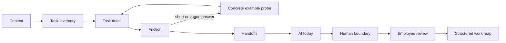

# Fieldwork interview agent

## Product job

Fieldwork helps a large company see where AI can improve work by interviewing a defensible sample of employees, extracting evidence from their answers, and passing that evidence into a roadmap. The interview agent is the first step in that system.

The agent asks about the work people repeat, how long it takes, which tools it touches, what makes it difficult, where it waits, how people already use AI, and which decisions must stay human. Every roadmap number comes from that record.

## Sampling policy

The workspace uses a proportional sample per team. The first prototype uses a finite-population approximation for a 95% confidence level and roughly ±10% precision:

```text
sample = population / (1 + population × margin_of_error²)
```

The result is rounded up and each team receives a minimum of three people when its population allows it. This is a discovery starting point, not a replacement for a statistician when a company needs a formally powered study. The UI shows the target, current coverage, remaining invites, employee time required, and the opportunity cost of that time using the workspace hourly-cost assumption.

## Agent graph



The product implements this graph as a small typed state machine in `src/lib/engine/interview.ts`. That keeps the demo deterministic, inspectable, and usable without an API key. The agent is still adaptive: short pain descriptions receive a follow-up, tools are extracted from free text, and each task is classified before it enters the work map.

## Agent capabilities

- Adaptive prompts driven by the current node and the task being discussed.
- Follow-up questions when a friction answer is too short to support a decision.
- Structured extraction of task names, hours, tools, pain, waits, AI use, and human boundaries.
- Employee review before submission.
- Optional Jev classification after the interview. Low-confidence classifications keep the rule-based answer and remain visible for review.

## What is live in the prototype

The browser chat in Discovery is a working agent. A person can be invited, start the agent, answer in natural language, continue an incomplete interview, edit captured tasks, and submit the reviewed record. The sample planner prepares the next wave and produces an invite brief.

Email, SMS, SSO, consent management, audio transcription, and durable multi-tenant storage are deliberately separate transport and operations layers. They should be integrated after the question flow is validated with real participants.

## Safety and review boundaries

The agent does not promise savings to the employee, decide that a person should be replaced, or execute an automation. Jev only prioritizes opportunities after discovery. A company owner reviews the final roadmap, and low-confidence judgments stay on the rule-based answer.
