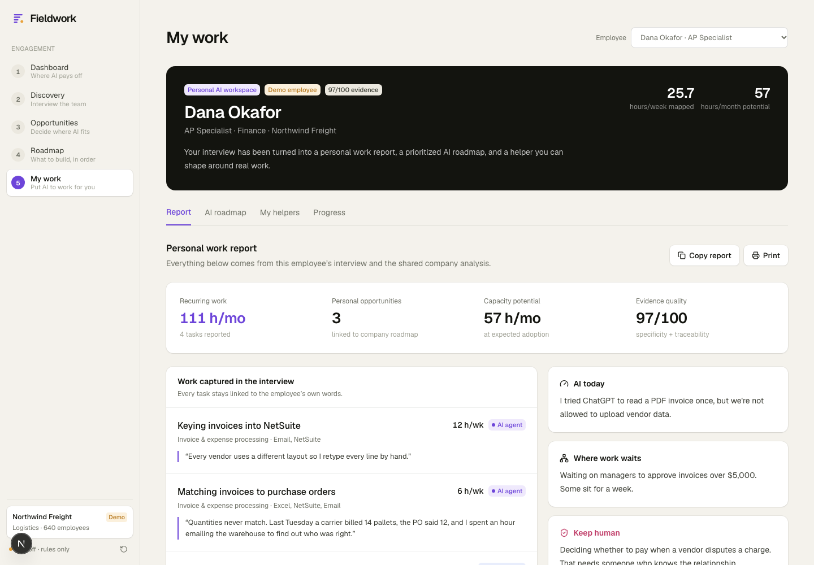

# My work — personalized employee AI workspace

`/my-work` turns every completed employee interview into three connected outputs:

1. A personal work report with the employee's tasks, time, tools, friction, dependencies, current AI use, and human boundaries.
2. A personal AI roadmap linked to the same opportunities, solution decisions, phases, and ROI assumptions used by the company roadmap.
3. A reusable helper configured around one of the employee's actual tasks, with company context and an explicit human checkpoint.

The profile is derived in `src/lib/personal/profile.ts`. It does not duplicate the company analysis. It filters the shared opportunity map down to the tasks reported by the selected employee, then calculates that employee's expected capacity using the solution capture and adoption assumptions.

## Employee report

The Report tab shows the full structured interview record and keeps each recommendation beside its evidence. It includes company and team sample context so a personal recommendation is not presented as an isolated idea. The report can be copied as Markdown or printed.

## Personal roadmap

The AI roadmap tab includes every opportunity connected to the employee, not one generic meeting use case. Each recommendation contains:

- The employee tasks and weekly hours behind it.
- The company process, solution type, and roadmap phase.
- The recommended action and human checkpoint.
- The operational metric and estimated monthly capacity.
- A 90-day Start → Practice → Scale adoption plan.

Capacity is an estimate based on reported hours, solution capture, adoption assumptions, and loaded hourly cost. It is never labelled as guaranteed cash savings.

## Personal helper

The five-step builder starts from the selected roadmap task:

1. **Your task** — confirm a task from the employee interview and define the goal.
2. **A good result** — choose the output structure and write reusable instructions.
3. **Your context** — use a safe sample, enter work context, or select a read-only Google Calendar event.
4. **Test & improve** — generate a local work brief or an AI draft and review the exact context used.
5. **Save & use** — save the recipe and record usefulness and self-reported time saved after each run.

Without `OPENAI_API_KEY`, the helper produces a clearly labelled local work brief. With a configured provider, `POST /api/helpers/meeting` uses the Responses API with a strict JSON schema. In both modes, the employee reviews the result and owns the final decision.

## Google Calendar connector

The Calendar connector is optional and read-only. It only supplies an event as context; it cannot create invitations or modify a calendar.

1. Enable the Google Calendar API and configure an OAuth consent screen.
2. Create a Web application OAuth client.
3. Add `http://localhost:3000/api/integrations/google/callback` as an authorized redirect URI.
4. Set `GOOGLE_CLIENT_ID`, `GOOGLE_CLIENT_SECRET`, and `GOOGLE_REDIRECT_URI` in `.env.local`.

Tokens live in server memory for up to eight hours. This is suitable for the local demo, not production token storage.

## Demo data integrity

`npm run check:demo` verifies that the mock company population, team roster, employee records, consent, task IDs, opportunity links, personal profiles, and follow-up initiatives remain internally consistent. Seeded task IDs are deterministic so records remain stable across resets.
